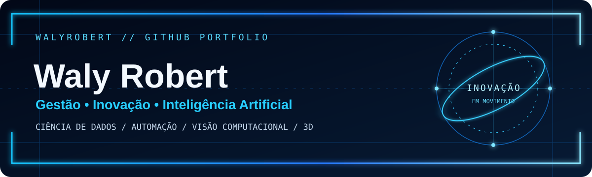

<!--
  WalyRobert | GitHub Profile
  Visual identity: dark navy + electric neon blue
-->

  

  

    <a href="https://github.com/WalyRobert?tab=repositories">REPOSITÓRIOS</a> ·
    <a href="https://github.com/WalyRobert?tab=projects">PROJETOS</a> ·
    <a href="https://github.com/WalyRobert?tab=stars">FAVORITOS</a>
  

  
  
  

---

## ▰ SOBRE MIM

Sou interessado na aplicação de tecnologia, inteligência artificial e ciência de dados para transformar ideias em soluções práticas. Minha trajetória combina gestão, inovação, pesquisa e experimentação tecnológica.

**Áreas de interesse**
- Inteligência artificial e aplicações práticas
- Ciência de dados e análise de informações
- Automação e visão computacional
- Experiências 3D, realidade virtual e vídeo imersivo
- Prototipagem e desenvolvimento de soluções

## ▰ PROJETOS EM DESTAQUE

<table>
  <tr>
    <td width="50%" valign="top">
      <h3>🤖 <a href="https://github.com/WalyRobert/gaby-app">Gaby App</a></h3>
      Assistente experimental que explora o uso de IA para interpretar instruções e simular automação de interfaces.
       React · TypeScript · Vite · IA
    </td>
    <td width="50%" valign="top">
      <h3>🍎 <a href="https://github.com/WalyRobert/FruitVision-Backend-YOLO11">FruitVision</a></h3>
      API de visão computacional para processamento de imagens, vídeos e frames, com suporte planejado a modelos YOLO11.
       Python · FastAPI · YOLO11 · OpenCV
    </td>
  </tr>
  <tr>
    <td width="50%" valign="top">
      <h3>🌐 <a href="https://github.com/WalyRobert/dr-360">DR 360°</a></h3>
      Player web experimental para vídeos panorâmicos, com visualização em esfera 3D e controles interativos.
       React · TypeScript · Three.js
    </td>
    <td width="50%" valign="top">
      <h3>🥽 <a href="https://github.com/WalyRobert/dr360-app">DR360 App</a></h3>
      Implementação independente voltada à visualização de vídeos 360° e experiências imersivas.
       React · TypeScript · Three.js
    </td>
  </tr>
  <tr>
    <td width="50%" valign="top">
      <h3>🎞️ <a href="https://github.com/WalyRobert/captura-de-quadro">Captura de Quadro</a></h3>
      Ferramenta local para extrair frames de vídeos e exportá-los em PNG ou JPG.
       JavaScript · Canvas · Vídeo
    </td>
    <td width="50%" valign="top">
      <h3>✨ <a href="https://github.com/WalyRobert/particle-magic-3d">Particle Magic 3D</a></h3>
      Experimento 3D com partículas, formas interativas, gestos e comandos de voz opcionais.
       Three.js · React Three Fiber · MediaPipe
    </td>
  </tr>
</table>

## ▰ TECNOLOGIAS E FERRAMENTAS

  

## ▰ EXPLORAR

Veja todos os projetos, experimentos e repositórios no [meu GitHub](https://github.com/WalyRobert?tab=repositories).

  
    
  CRIAR · APRENDER · EXPERIMENTAR · TRANSFORMAR

